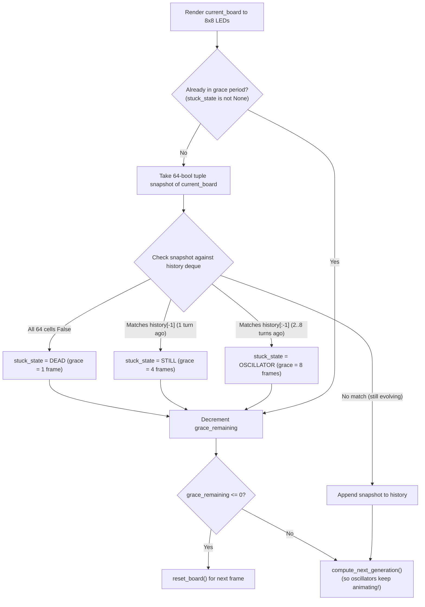

# Conway's Game of Life — Stuck-State Detection Plan

## Goal Description
Expand [`conway.py`](../conway.py) so `ConwayApp` automatically detects when the 8×8 board stops evolving meaningfully—whether because **all cells died**, the board reached a frozen **still life**, or it entered a repeating **oscillator** loop. Once detected, the board continues running for a state-specific grace period and then automatically resets to a new random generation.

---

## Design Rationale & Key Python Concepts

### 1. Why a 64-Boolean `tuple` Instead of Copying the 8×8 RGB Board?
Right now, `self.current_board` is designed for the Sense HAT hardware: it is an 8×8 grid (a `list` of 8 row `list`s), where every cell is a 3-number RGB `list` like `[0, 255, 0]` or `[0, 0, 0]`.
- **The Expensive Way (Deep Copying Lists):** If we saved the raw board into our history buffer every frame, Python would have to duplicate **1 outer list + 8 row lists + 64 RGB lists = 73 separate list objects** per frame (nearly 600 list objects for an 8-frame history). Even worse, because `compute_next_generation` reuses `self.current_board` and `self.next_board` by swapping them in place (double buffering), accidentally storing `self.current_board` directly without `copy.deepcopy()` would mean every slot in your history points to the *same* live board!
- **The Hyper-Efficient Way (64-Boolean `tuple`):** For game rules, a cell only has two states: alive (`True`) or dead (`False`). By flattening the board into a `tuple` of 64 booleans:
  1. **Tiny & Single-Object:** It is **1 single flat object** in memory instead of 73 nested lists—like taking a photo of a 64-switch breaker panel instead of rebuilding the whole wall.
  2. **Immutable (Read-Only):** A `tuple` in Python cannot be modified after it is created. Once we snap that picture and drop it in the history tray, double-buffering on `self.current_board` can never accidentally overwrite our saved history.
  3. **Fast Comparison:** When Python compares two 64-boolean tuples (`snapshot == old_snapshot`), it checks them element-by-element in C and stops at the very first square that differs.

---

### 2. Why `collections.deque(maxlen=8)` Instead of a Standard Python `list`?
To catch oscillators that take up to 8 steps to repeat, we only ever care about the **most recent 8 generations**.
- **If we used a standard `list`:** Every single frame, we would have to `.append(snapshot)` and then manually check `if len(history) > 8: history.pop(0)`. In Python, `list.pop(0)` has to shift every remaining item in the list one slot to the left in memory—like making everyone in a movie theater line take one step forward.
- **With `deque(maxlen=8)` (Double-Ended Queue):** Think of `deque` with `maxlen=8` as a **spring-loaded cafeteria tray dispenser** or a conveyor belt that is exactly 8 slots long:
  - You just call `self.history.append(snapshot)`.
  - If there are already 8 snapshots inside, `deque` automatically drops the oldest one off the back end in a single step ($O(1)$ constant time), with zero manual `if len(...)` bookkeeping and zero memory shifting.

---

### 3. Why the Order of Checks in `detect_stuck_state()` Matters
When inspecting a new `snapshot`, we check the three conditions in a specific order:

```python
if not any(snapshot):
    return STATE_DEAD
if history and snapshot == history[-1]:
    return STATE_STILL
if snapshot in history:
    return STATE_OSCILLATOR
return None
```

1. **`not any(snapshot)` (Extinction Check):**
   Python's built-in `any()` function is **lazy (short-circuiting)**. It looks at the first cell in the tuple: as soon as it sees even *one* `True` (living cell), it stops immediately and says "not dead!" It only looks at all 64 cells on the rare frame where the entire board just went black.
2. **`history and snapshot == history[-1]` (Still-Life Check):**
   In Python, `history[-1]` grabs the snapshot from **1 frame ago** (the top of the tray). If the board is identical to 1 frame ago, nothing was born and nothing died—it is permanently frozen (`STATE_STILL`). Checking `history[-1]` *before* searching the whole tray is how we distinguish a frozen **Still Life** (period 1) from a blinking **Oscillator** (period 2+).
3. **`snapshot in history` (Oscillator Check):**
   If we reach this line, we already know the board has living cells and is *different* from 1 frame ago. So if `snapshot in history` finds a match anywhere else in the tray (2 to 8 frames ago), the board must be cycling through a multi-frame loop (`STATE_OSCILLATOR`).

---

### 4. Why Generations Keep Advancing During the Grace Period
Notice in the flow diagram below that when `self.stuck_state` is active and `self.grace_remaining > 0`, we **still call `compute_next_generation()`** at the bottom of `draw()`.
- Why? If we stopped computing the next generation the moment we detected an **Oscillator**, a blinking pattern would suddenly freeze still during its 4-second grace period!
- By letting `compute_next_generation()` keep running while `self.grace_remaining` ticks down to `0`, an oscillator continues to blink naturally on the 8×8 LED matrix for all 8 grace frames (4 seconds) before resetting. Meanwhile, during a grace period we skip taking new snapshots (`if self.stuck_state is None:`), because we already know the board's fate and are simply counting down to the reset.



---

## Proposed Changes

### Conway Game Module

#### [MODIFY] [conway.py](../conway.py)

1. **Import `deque` and add stuck-state constants:**
   - Import `from collections import deque` at the top of the file.
   - Add constants for the history window size, state names, and grace periods (in frames, where 1 frame = `0.5s`):

```python
HISTORY_SIZE = 8           # Number of prior generations to remember

STATE_DEAD = "DEAD"
STATE_STILL = "STILL"
STATE_OSCILLATOR = "OSCILLATOR"

GRACE_FRAMES = {
    STATE_DEAD: 1,         # 0.5s on a dark screen before resetting
    STATE_STILL: 4,        # 2.0s to admire frozen shapes before resetting
    STATE_OSCILLATOR: 8,   # 4.0s to watch repeating loops blink before resetting
}
```

2. **Add two pure helper functions (`snapshot_board` and `detect_stuck_state`):**
   - `snapshot_board(board)` converts the 8×8 color grid into a 64-boolean `tuple`.
   - `detect_stuck_state(snapshot, history)` inspects the snapshot and the `history` tray to return `STATE_DEAD`, `STATE_STILL`, `STATE_OSCILLATOR`, or `None`.

```python
def snapshot_board(board):
    """Create a lightweight 64-boolean tuple representing living cells on the board."""
    return tuple(
        pixel == ALIVE_COLOR
        for row in board
        for pixel in row
    )


def detect_stuck_state(snapshot, history):
    """
    Check if the current board snapshot is stuck.
    Returns STATE_DEAD, STATE_STILL, STATE_OSCILLATOR, or None.
    """
    if not any(snapshot):
        return STATE_DEAD
    if history and snapshot == history[-1]:
        return STATE_STILL
    if snapshot in history:
        return STATE_OSCILLATOR
    return None
```

3. **Update `ConwayApp` to track history and handle the grace-period countdown:**
   - In `__init__` and `reset_board`, initialize `self.history = deque(maxlen=HISTORY_SIZE)`, `self.stuck_state = None`, and `self.grace_remaining = 0`.
   - In `draw`, check for a stuck state after drawing the current frame, count down `self.grace_remaining` while still advancing the generation (so oscillators keep blinking during their grace period!), and call `self.reset_board()` once the countdown hits `0`.

```diff
     def __init__(self):
-        self.current_board = create_random_board()
-        self.next_board = create_empty_board()
+        self.reset_board()
```

```diff
     def reset_board(self):
-        """Randomize the current board and clear the secondary buffer."""
+        """Randomize the current board, clear the secondary buffer, and reset history."""
         self.current_board = create_random_board()
         self.next_board = create_empty_board()
+        self.history = deque(maxlen=HISTORY_SIZE)
+        self.stuck_state = None
+        self.grace_remaining = 0
```

```diff
     def draw(self, sense):
         """Render the current generation and advance the board by one step."""
         sense.set_pixels(flatten_board(self.current_board))
+
+        if self.stuck_state is None:
+            snapshot = snapshot_board(self.current_board)
+            self.stuck_state = detect_stuck_state(snapshot, self.history)
+            self.history.append(snapshot)
+            if self.stuck_state is not None:
+                self.grace_remaining = GRACE_FRAMES[self.stuck_state]
+
+        if self.stuck_state is not None:
+            self.grace_remaining -= 1
+            if self.grace_remaining <= 0:
+                self.reset_board()
+                return
+
         compute_next_generation(self.current_board, self.next_board)
         self.current_board, self.next_board = self.next_board, self.current_board
```

---

## Verification Plan

### Automated Verification
- Run a quick Python verification test against `snapshot_board`, `detect_stuck_state`, and `ConwayApp` using known 8×8 test boards:
  1. **All Dead:** Empty board $\rightarrow$ detects `STATE_DEAD` and resets after 1 frame.
  2. **Still Life:** 2×2 square ("Block") $\rightarrow$ detects `STATE_STILL` on generation 2 and resets after 4 grace frames.
  3. **Oscillator:** 1×3 line ("Blinker") $\rightarrow$ detects `STATE_OSCILLATOR` on generation 3, keeps blinking for 8 grace frames, and then resets.
- Run `ruff check conway_game/conway.py` in `.venv` to confirm clean formatting and zero lint warnings.

### Manual Verification on the RP5 Sense HAT Emulator
- Launch `conway.py` (or `main.py`) with the Sense HAT Emulator open and watch the 8×8 grid automatically detect stagnating boards and restart after the grace period.

