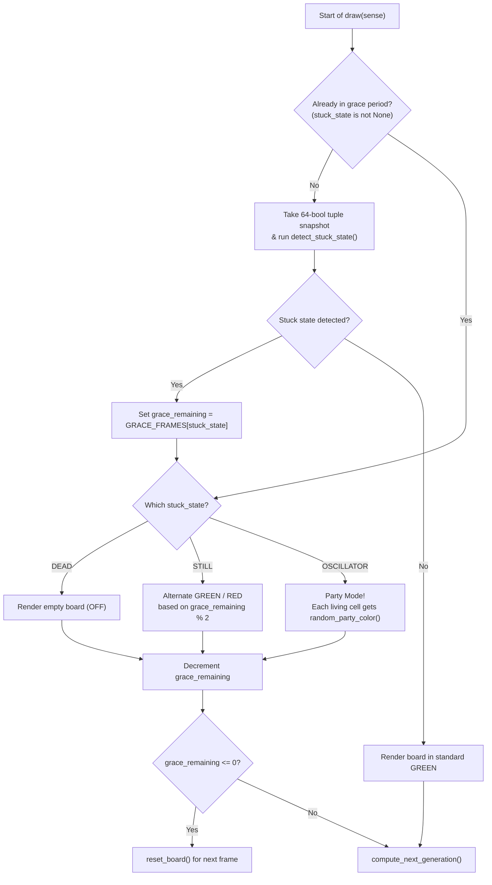

# Conway's Game of Life — Still-Life Alert & Oscillator Party Mode Plan

## Goal Description
Add visual celebrations and alerts to [`conway.py`](../conway.py) when `ConwayApp` detects a stuck state:
1. **Still Life (`STATE_STILL`):** Flash the living cells back and forth between standard **Green** (`[0, 255, 0]`) and **Red** (`[255, 0, 0]`) for **8 frames** (`4.0s`) before resetting.
2. **Oscillator (`STATE_OSCILLATOR`):** Party Mode! While the oscillator continues animating through its cycle during the grace period, light up every living cell with a **random vibrant color** on each frame before resetting.

---

## Design Rationale & Key Python Concepts

### 1. Separating Game Logic from Visual Colors ("Model vs. View")
Right now, `count_neighbors` and `compute_next_generation` check if a cell is alive by testing:
```python
board[neighbor_row][neighbor_col] == ALIVE_COLOR  # [0, 255, 0]
```
- **The Trap (Mutating the Board Directly):** If we painted random party colors (`[255, 0, 180]`, `[0, 220, 255]`) directly into `self.current_board`, then on the very next frame `count_neighbors()` would compare `[255, 0, 180] == [0, 255, 0]`, get `False`, and think every partying cell just died!
- **The Clean Architecture (Paint on the Way to the Screen):** Think of `self.current_board` like the **sheet music** (which only cares whether a note is played or silent) and the Sense HAT LEDs like the **stage lights**.
  - We keep `self.current_board` strictly using `ALIVE_COLOR` and `DEAD_COLOR` so the game rules never break.
  - When sending the board to `sense.set_pixels(...)`, our rendering function translates each living cell into the right display color based on `self.stuck_state` (Green, flashing Red/Green, or random Party Colors).

---

### 2. Why Pure `random.randint(0, 255)` Makes Bad LED Party Lights (and the Fix)
If you pick Red, Green, and Blue completely at random from `0` to `255`, you will frequently roll dark combinations like `[12, 4, 19]` (nearly black—looks like a dead cell on the Sense HAT!) or `[200, 210, 195]` (washed-out white/grey).
- **How to Guarantee Vibrant Party Colors (`random_party_color()`):**
  Think of an RGB color mixer with three sliders (Red, Green, Blue):
  1. Force **at least one slider** all the way up (`200–255`) so the LED is always bright.
  2. Force **at least one slider** all the way down (`0–50`) so the color stays saturated and neon instead of turning white.
  3. Let the **third slider** be anything (`0–255`).
  4. Shuffle the three sliders (`random.shuffle`)!
  This tiny 4-line recipe produces pure, glowing neon colors (magentas, cyans, golds, electric blues, oranges, purples) and *never* rolls a dim or muddy pixel.

---

### 3. Why We Detect the Stuck State *Before* Calling `sense.set_pixels()`
In our previous version, `sense.set_pixels()` was on the very first line of `draw()`, and `detect_stuck_state()` ran *after* it.
- By moving `sense.set_pixels(...)` **below** the `detect_stuck_state()` check:
  - As soon as a board repeats, we immediately know `self.stuck_state` and `self.grace_remaining` **before** lighting up the LEDs for that frame.
  - For `STATE_STILL` (`GRACE_FRAMES[STATE_STILL] = 8`), we check `self.grace_remaining % 2` (even vs. odd countdown numbers) to alternate cleanly between **Green** and **Red** across all 8 grace frames.



---

## Proposed Changes

### Conway Game Module

#### [MODIFY] [conway.py](../conway.py)

1. **Add `STILL_ALERT_COLOR` and update `GRACE_FRAMES`:**
   - Add `STILL_ALERT_COLOR = [255, 0, 0]  # Red` alongside `ALIVE_COLOR` and `DEAD_COLOR`.
   - Update `STATE_STILL` in `GRACE_FRAMES` from `4` to `8` frames (`4.0s`) so it flashes Green/Red for 8 frames.

```diff
 ALIVE_COLOR = [0, 255, 0]  # Green
+STILL_ALERT_COLOR = [255, 0, 0]  # Red flash for frozen still lifes
 DEAD_COLOR = [0, 0, 0]     # Off
 FRAME_DELAY = 0.5          # Seconds between generations
 HISTORY_SIZE = 8           # Number of prior generations to remember
 
 STATE_DEAD = "DEAD"
 STATE_STILL = "STILL"
 STATE_OSCILLATOR = "OSCILLATOR"
 
 GRACE_FRAMES = {
     STATE_DEAD: 1,         # 0.5s on a dark screen before resetting
-    STATE_STILL: 4,        # 2.0s to admire frozen shapes before resetting
+    STATE_STILL: 8,        # 4.0s (8 frames) flashing Green/Red before resetting
     STATE_OSCILLATOR: 8,   # 4.0s to watch repeating loops blink before resetting
 }
```

2. **Add `random_party_color()` and update `flatten_board()` to support stuck-state colors:**
   - Add `random_party_color()` to generate bright, saturated RGB colors for oscillators.
   - Update `flatten_board(board, stuck_state=None, grace_remaining=0)` so each living cell is colored according to the active state:
     - `STATE_STILL`: alternates between `ALIVE_COLOR` (Green) and `STILL_ALERT_COLOR` (Red) every frame using `grace_remaining % 2`.
     - `STATE_OSCILLATOR`: calls `random_party_color()` for each living cell.
     - Otherwise: uses standard `ALIVE_COLOR` (Green).

```python
def random_party_color():
    """Generate a bright, saturated random [R, G, B] color for Oscillator Party Mode."""
    channels = [
        random.randint(200, 255),  # One high channel guarantees brightness
        random.randint(0, 50),     # One low channel guarantees vivid color (not white)
        random.randint(0, 255),    # One free channel for variety
    ]
    random.shuffle(channels)
    return channels


def flatten_board(board, stuck_state=None, grace_remaining=0):
    """
    Flatten the 8x8 2D board into a 64-element pixel list for sense.set_pixels(),
    applying visual effects when the board is in a stuck state.
    """
    pixels = []
    for row in board:
        for cell in row:
            if cell != ALIVE_COLOR:
                pixels.append(DEAD_COLOR)
            elif stuck_state == STATE_STILL:
                # Alternate between Green and Red across the 8 grace frames
                color = ALIVE_COLOR if grace_remaining % 2 == 0 else STILL_ALERT_COLOR
                pixels.append(color)
            elif stuck_state == STATE_OSCILLATOR:
                pixels.append(random_party_color())
            else:
                pixels.append(ALIVE_COLOR)
    return pixels
```

3. **Update `ConwayApp.draw()` to detect state before rendering:**
   - Check `detect_stuck_state()` first, then call `sense.set_pixels(flatten_board(self.current_board, self.stuck_state, self.grace_remaining))` so all 8 grace frames show the visual effect.

```diff
     def draw(self, sense):
         """Render the current generation and advance the board by one step."""
-        sense.set_pixels(flatten_board(self.current_board))
-
         if self.stuck_state is None:
             snapshot = snapshot_board(self.current_board)
             self.stuck_state = detect_stuck_state(snapshot, self.history)
             self.history.append(snapshot)
             if self.stuck_state is not None:
                 self.grace_remaining = GRACE_FRAMES[self.stuck_state]
 
+        sense.set_pixels(
+            flatten_board(self.current_board, self.stuck_state, self.grace_remaining)
+        )
+
         if self.stuck_state is not None:
             self.grace_remaining -= 1
             if self.grace_remaining <= 0:
                 self.reset_board()
                 return
 
         compute_next_generation(self.current_board, self.next_board)
         self.current_board, self.next_board = self.next_board, self.current_board
```

---

## Verification Plan

### Automated Verification
- Update and run the verification test script to confirm:
  1. **Still Life (2×2 Block):** Once `STATE_STILL` is detected, runs for **8 frames**, alternating the living pixels strictly between `[0, 255, 0]` (Green) and `[255, 0, 0]` (Red) on each frame before resetting.
  2. **Oscillator (1×3 Blinker):** Once `STATE_OSCILLATOR` is detected, continues oscillating horizontally and vertically for **8 frames** while assigning bright random RGB colors (`max(color) >= 200`) to every living pixel without breaking `compute_next_generation()`.
- Run `ruff check conway_game/conway.py` in `.venv`.

