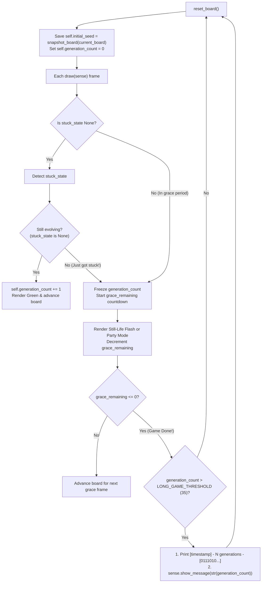

# Conway's Game of Life — Long-Game Seed Logger & Score Display Plan

## Goal Description
Track how many generations each random board in [`conway.py`](../conway.py) survives before getting stuck, along with a snapshot of its starting seed:
1. On every new game (`reset_board()`), save the starting board's 64-cell snapshot in `self.initial_seed` and set `self.generation_count = 0`.
2. Increment `self.generation_count` on each active generation (before the board enters a stuck state).
3. If `self.generation_count > LONG_GAME_THRESHOLD` (`N = 35`), wait until the end-of-game grace period animations finish (`grace_remaining <= 0`), and then right before resetting the board:
   - **Display the total generation count on the 8×8 LEDs** using `sense.show_message()` (dimmed with `scale_color()`).
   - **Print the timestamp, generation count, and compact 64-bit seed string** to the console in the format:
     `[current_system_time] - N generations - [0111010...]`

---

## Design Rationale & Key Python Concepts

### 1. Freezing the Generation Counter During the Grace Period (While Waiting to Display It)
When an oscillator is detected, the board keeps running for 22 grace frames (`6` spinning frames + `16` Party Mode frames) before resetting.
- **The Subtle Bug if You Count Grace Frames:** If we incremented `self.generation_count` on every `draw()` call including the grace period, any oscillator that formed on Turn 3 would get `+22` bonus points from the party animation and report `25` generations!
- **The Clean Solution:**
  - We increment `self.generation_count += 1` **only while `self.stuck_state is None`** (when the board is genuinely evolving into a brand-new state).
  - Once a stuck state is detected, `self.generation_count` freezes at its true evolutionary score while the Still-Life Red/Green flash or Oscillator Party Mode plays out.
  - Then, when `self.grace_remaining <= 0` (right before `self.reset_board()`), we check `if self.generation_count > LONG_GAME_THRESHOLD:` to scroll the score on the LEDs and log the seed to the console.

---

### 2. Why `"".join("1" if cell else "0" for cell in initial_seed)` Is Ideal for Logging
Our `snapshot_board()` helper returns a 64-element tuple of `True` and `False`.
- Printing a 64-item tuple with commas and spaces takes nearly 200–400 characters and wraps across multiple lines in the terminal.
- Using Python's `"".join(...)` stitches all 64 booleans into a single, unbroken 64-character string of `0`s and `1`s (`[0111010...]`). Every logged game fits cleanly on one line in your terminal, and if you ever want to replay a seed later, each character (`"0"` or `"1"`) maps 1-to-1 back to the 64 squares on the board!

---

### 3. Bumping `HISTORY_SIZE` from `8` to `20`
Our 5,000-game simulation showed that ~0.3% of 8×8 random boards settle into a large oscillator that takes **10 to 16 steps** to repeat.
- With `HISTORY_SIZE = 8`, a 12-step oscillator never matches the last 8 snapshots, so the game thinks it is still evolving forever and would falsely report an infinite generation score!
- Increasing `HISTORY_SIZE` to `20` costs almost zero memory (just 12 extra 64-boolean tuples) and ensures even complex multi-step oscillators are accurately caught.



---

## Proposed Changes

### Conway Game Module

#### [MODIFY] [conway.py](../conway.py)

1. **Update `HISTORY_SIZE = 20` and add `LONG_GAME_THRESHOLD = 35` with statistical comments:**

```python
HISTORY_SIZE = 20                # Number of prior generations to remember (catches long-period oscillators)

# Minimum generations (N) before logging the seed and scrolling the score on the LEDs.
# Based on 5,000 simulated 8x8 games (alive_probability = 0.35):
#   - Median (50%): 16 generations | Average: 22 generations
#   - N = 35: Top ~15% of games (good for frequent testing/excitement)
#   - N = 50: Top ~7% of games (~1 in 15 games)
#   - N = 64: Top ~3% of games (~1 in 33 games — more generations than squares on the 8x8 grid!)
#   - N = 80: Top ~1% of games (~1 in 100 games — true marathon seeds)
LONG_GAME_THRESHOLD = 35
```

2. **Add `log_and_display_long_game(sense, generation_count, initial_seed)` helper:**

```python
def log_and_display_long_game(sense, generation_count, initial_seed):
    """Log a long-running seed to the console and scroll the generation count on the LEDs."""
    timestamp = time.strftime("%Y-%m-%d %H:%M:%S")
    seed_bits = "".join("1" if cell else "0" for cell in initial_seed)
    print(f"[{timestamp}] - {generation_count} generations - [{seed_bits}]", flush=True)
    sense.show_message(str(generation_count), text_colour=scale_color(ALIVE_COLOR))
```

3. **Track `self.initial_seed` and `self.generation_count` in `ConwayApp`:**
   - Initialize `self.initial_seed` and `self.generation_count = 0` in `reset_board()`.
   - Increment `self.generation_count += 1` while `self.stuck_state is None` in `draw()`, and call `log_and_display_long_game()` right before resetting when `self.generation_count > LONG_GAME_THRESHOLD`.

