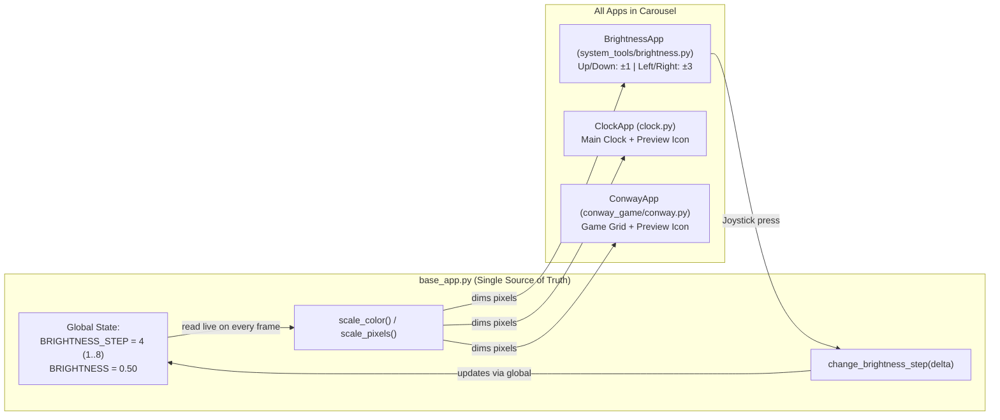

# Global Brightness & Brightness Control App (`system_tools/brightness.py`) Plan

## Goal Description
1. Fix [`ClockApp`](../../clock.py) (both the main clock display and its App Picker preview icon) so it uses the same software brightness dimming as [`ConwayApp`](../../conway_game/conway.py).
2. Promote `BRIGHTNESS` to a **global setting** (8 steps from `1` to `8`, where each step is `12.5%` brightness, defaulting to Step `4` = `50%`).
3. Create a new `system_tools/` folder containing [`system_tools/brightness.py`](../brightness.py) (`BrightnessApp`), placed at the end of the `apps` list in [`main.py`](../../main.py) so pressing **Left** from the Clock homepage jumps straight to its **8×8 Lightbulb icon**.
4. Inside `BrightnessApp`, show the glowing lightbulb alongside an **8-dot vertical level meter** on the right edge, with joystick controls:
   - **Up:** `+1` step
   - **Down:** `-1` step
   - **Right:** `+3` steps
   - **Left:** `-3` steps
   - **Center Button:** Return to the Clock homepage (now dimmed at the newly chosen global brightness).

---

## Design Rationale & Key Python Concepts

### 1. The "Photocopy Trap" with Python Global Variables Across Files
In Python, if you put `BRIGHTNESS = 0.5` inside `base_app.py` and then write `from base_app import BRIGHTNESS` at the top of `clock.py`, Python **copies** the value `0.5` into a brand-new variable inside `clock.py` at the moment the program starts.
- **The Trap:** Think of `from base_app import BRIGHTNESS` like making a paper photocopy of a sticky note. If `brightness.py` later writes a new number on the original sticky note in `base_app.py`, `clock.py` is still looking at its old photocopy and never sees the change!
- **The Solution (Centralized State + Helper Functions in `base_app.py`):**
  Instead of each file importing a raw number at startup, we keep the global variables `BRIGHTNESS_STEP` and `BRIGHTNESS` inside [`base_app.py`](../../base_app.py) and provide shared functions (`scale_color()`, `scale_pixels()`, `get_brightness_step()`, `change_brightness_step(delta)`):
  - When you press Up/Down/Left/Right in `system_tools/brightness.py`, it calls `change_brightness_step(delta)`, which uses Python's `global` keyword to update `BRIGHTNESS_STEP` and `BRIGHTNESS` right at the source in `base_app.py`.
  - When `clock.py`, `conway.py`, or `brightness.py` draws a frame, calling `scale_color()` or `scale_pixels()` reads the **live** global `BRIGHTNESS` in `base_app.py` on every frame.

---

### 2. Why an 8-Step Scale (`1..8`) Matches Both the Grid and the Hardware
1. **1-to-1 Visual Fit:** Because the Sense HAT is an **8×8** matrix, an 8-step scale (`1` to `8`) means the vertical meter bar on the right column (`col 7`) lights up **1 pixel per step** from bottom (`row 7`) to top (`row 0`).
2. **Clamping with `max(1, min(8, new_step))`:**
   - Why clamp the minimum at Step `1` (`12.5%`) instead of `0` (`0%`)? If you allowed Step `0`, the entire 8×8 LED screen would turn completely black (`[0, 0, 0]`), making the Pi look like it crashed or powered off!
   - Why clamp the maximum at Step `8` (`100%`)? Passing any RGB value above `255` to `sense.set_pixels()` raises a `ValueError` crash in the Sense HAT library. Clamping between `1` and `8` guarantees `BRIGHTNESS` stays safely between `0.125` and `1.0`.



---

## Proposed Changes

### 1. Shared Brightness Globals & Helpers

#### [MODIFY] [base_app.py](../../base_app.py)
- Add the global `MAX_BRIGHTNESS_STEPS = 8`, `BRIGHTNESS_STEP = 4`, and `BRIGHTNESS = BRIGHTNESS_STEP / MAX_BRIGHTNESS_STEPS` (`0.5`).
- Add `get_brightness_step()`, `change_brightness_step(delta)`, `scale_color(color)`, and `scale_pixels(pixels)`.
- Default `BaseApp.low_light = True` and dim `BaseApp.draw_preview` using `scale_color`.

```python
MAX_BRIGHTNESS_STEPS = 8
BRIGHTNESS_STEP = 4  # Default to 4/8 (50% brightness)
BRIGHTNESS = BRIGHTNESS_STEP / MAX_BRIGHTNESS_STEPS


def get_brightness_step():
    """Return the current brightness step (1 to 8)."""
    return BRIGHTNESS_STEP


def change_brightness_step(delta):
    """Adjust the global brightness step by delta, clamped safely between 1 and 8."""
    global BRIGHTNESS_STEP, BRIGHTNESS
    BRIGHTNESS_STEP = max(1, min(MAX_BRIGHTNESS_STEPS, BRIGHTNESS_STEP + delta))
    BRIGHTNESS = BRIGHTNESS_STEP / MAX_BRIGHTNESS_STEPS
    return BRIGHTNESS_STEP


def scale_color(color):
    """Dim an [R, G, B] color using the live global BRIGHTNESS factor."""
    return [int(channel * BRIGHTNESS) for channel in color]


def scale_pixels(pixels):
    """Dim a 64-pixel list of [R, G, B] colors using the live global BRIGHTNESS factor."""
    return [scale_color(pixel) for pixel in pixels]
```

---

### 2. Fix Clock Main Display & Preview Icon Brightness

#### [MODIFY] [clock.py](../../clock.py)
- Import `scale_color` and `scale_pixels` from `base_app`.
- In `build_clock_pixels`, compute `dim_hour = scale_color(hourColour)` and `dim_minute = scale_color(minuteColour)` so the main clock display automatically reflects the global `BRIGHTNESS`.
- In `ClockApp.draw_preview`, wrap `clock_icon` with `scale_pixels(clock_icon)` so the Clock icon in the App Picker isn't blindingly bright.

---

### 3. Switch Conway to Use the Shared Global Brightness

#### [MODIFY] [conway.py](../../conway_game/conway.py)
- Import `scale_color` from `base_app` instead of defining a local `BRIGHTNESS` constant and local `scale_color` inside `conway.py`.

---

### 4. Create the `system_tools/` Package & Brightness App

#### [NEW] [__init__.py](../__init__.py)
- Empty package marker file (matching `conway_game/__init__.py`) so `from system_tools.brightness import BrightnessApp` works cleanly.

#### [NEW] [brightness.py](../brightness.py)
- Create `BrightnessApp(BaseApp)`:
  - **`draw_preview(sense)`:** Renders a centered 8×8 glowing yellow lightbulb icon (`scale_pixels`).
  - **`draw(sense)`:** Renders the glowing lightbulb on columns `0..5` plus an **8-dot vertical level meter** on column `7` (lighting up `BRIGHTNESS_STEP` dots from the bottom row `7` up to row `0`), all scaled by the live global `BRIGHTNESS`.
  - **Joystick handlers:**
    - `on_up()`: `change_brightness_step(+1)`
    - `on_down()`: `change_brightness_step(-1)`
    - `on_right()`: `change_brightness_step(+3)`
    - `on_left()`: `change_brightness_step(-3)`

---

### 5. Register `BrightnessApp` Last in `main.py`

#### [MODIFY] [main.py](../../main.py)
- Import `BrightnessApp` from `system_tools.brightness` and append it to the end of `apps`:
```python
    apps = [
        home_app,
        ConwayApp(),
        BrightnessApp(),
    ]
```
  Because pressing **Left** on the Clock homepage selects `(len(apps) - 1) % len(apps)`, pressing **Left** once from the Clock lands directly on `BrightnessApp`!

